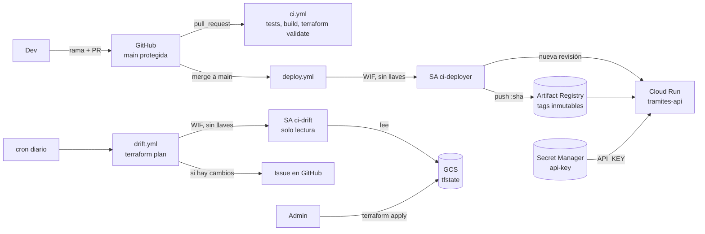

# tramites-platform

Plataforma mínima para desplegar `tramites-api`, el servicio de consulta de estado de trámite del Ministerio de Trámites Ciudadanos (ficticio), en Cloud Run.

- **Parte B elegida:** Opción 2, detección de drift.
- **Proyecto GCP:** `<PROJECT_ID>`
- **URL:** `<SERVICE_URL>`

## Diagrama



## Endpoints

| Ruta | Respuesta |
|---|---|
| `GET /health` | `{"status":"ok","api_key_cargada":true}`. Nunca muestra la llave. |
| `GET /tramites/{numero}` | Estado del trámite (datos simulados: 1001, 1002, 1003) |

## Desplegar desde cero

Requisitos: `gcloud`, `terraform` 1.17+, `git`, `gh` y `docker`.

```bash
export PROJECT_ID=<PROJECT_ID> REGION=us-central1 BILLING=<BILLING_ACCOUNT_ID>
```

**1. Proyecto y credenciales locales**
```bash
gcloud projects create $PROJECT_ID
gcloud billing projects link $PROJECT_ID --billing-account $BILLING
gcloud config set project $PROJECT_ID
gcloud services enable serviceusage.googleapis.com cloudresourcemanager.googleapis.com storage.googleapis.com billingbudgets.googleapis.com
gcloud auth application-default login
gcloud auth application-default set-quota-project $PROJECT_ID
```

**2. Bucket del estado de Terraform.** Se crea con gcloud porque Terraform necesita el bucket antes de poder guardar su propio estado.
```bash
gcloud storage buckets create gs://$PROJECT_ID-tfstate --location=$REGION \
  --uniform-bucket-level-access --public-access-prevention
gcloud storage buckets update gs://$PROJECT_ID-tfstate --versioning
```

**3. Terraform init**
```bash
cd infra
cp terraform.tfvars.example terraform.tfvars   # llenar valores (archivo ignorado por git)
terraform init -backend-config="bucket=$PROJECT_ID-tfstate"
```

**4. Secreto y resto de la infraestructura.** Cloud Run necesita que el secreto ya tenga una versión al crear la revisión, por eso hay un primer apply limitado al secreto.
```bash
terraform apply -target=google_secret_manager_secret.api_key
printf '%s' "$(openssl rand -hex 24)" | gcloud secrets versions add api-key --data-file=-
terraform apply
```

**5. Variables del repo en GitHub.** Son identificadores, no secretos; el repo no tiene ningún secreto guardado.
```bash
gh variable set PROJECT_ID --body "$PROJECT_ID"
gh variable set REGION --body "$REGION"
gh variable set TF_STATE_BUCKET --body "$PROJECT_ID-tfstate"
gh variable set BILLING_ACCOUNT --body "$BILLING"
gh variable set WIF_PROVIDER --body "$(terraform output -raw wif_provider)"
gh variable set DEPLOYER_SA --body "$(terraform output -raw deployer_sa)"
gh variable set DRIFT_SA --body "$(terraform output -raw drift_sa)"
```

**6. Desplegar la app:** se fusiona un PR a `main` y `deploy.yml` construye la imagen, la publica y la despliega.

**7. Destruir todo**
```bash
cd infra && terraform destroy
gcloud storage rm -r gs://$PROJECT_ID-tfstate
```

## Flujo de trabajo

- Trunk-based: `feature/DEVOPS-XX-descripcion`, `fix/DEVOPS-XX`, `hotfix/DEVOPS-XX`.
- Conventional Commits (`feat:`, `fix:`, `chore:`, `docs:`, `security:`).
- `main` está protegida: todo entra por PR y el check `ci` tiene que estar en verde.
- Cada imagen lleva como tag el SHA corto del commit. Artifact Registry no deja sobrescribir tags y nunca se usa `:latest`.

## Seguridad del pipeline

| Control | Qué evita |
|---|---|
| WIF, sin llaves JSON | Que una credencial de larga vida se filtre |
| Una SA por trabajo, con permisos a nivel recurso | Que un pipeline comprometido pueda tocar todo el proyecto |
| `ci.yml` no se autentica en GCP | Que un PR malicioso llegue a la nube |
| gitleaks sobre toda la historia en cada PR | Que entre un secreto, aunque se haya borrado en un commit posterior |
| Trivy sobre la imagen (HIGH/CRITICAL con arreglo disponible) | Desplegar una imagen con vulnerabilidades conocidas |
| Contenedor non-root, multistage y tags inmutables | Que un atacante sea root, y que una imagen ya probada se reemplace |

Trivy encontró dos CVE HIGH en `starlette` (la versión que traía FastAPI). Lo corregí fijando `starlette==1.7.0` en `requirements.txt`.

Los escáneres corren como imágenes de Docker con versión fija y no como Actions de terceros. Así un tag de una Action modificado por su autor no cambia lo que corre en el pipeline.

## Decisiones

| # | Decisión | Lo que descarté | Por qué |
|---|---|---|---|
| 1 | GitHub Actions entra a GCP con Workload Identity Federation | Llave JSON de una SA guardada como secreto de GitHub | La llave es una credencial de larga vida que se puede filtrar. Con WIF el token dura minutos, solo sirve para este repo y solo desde `main`. |
| 2 | Terraform lo aplica el admin; el pipeline solo despliega imágenes | Correr `terraform apply` en el pipeline | Para aplicar, la SA del pipeline necesitaría crear SAs y dar permisos (casi owner). Separado, `ci-deployer` solo puede subir imágenes y crear revisiones de un servicio. |
| 3 | El valor del secreto se crea con `gcloud`, fuera de Terraform | `google_secret_manager_secret_version` con el valor en Terraform | El valor quedaría en texto plano en el estado. Terraform solo crea el secreto y le da acceso a la SA de la app. |
| 4 | Tag = SHA del commit, con tags inmutables | `:latest` o tags que se pueden sobrescribir | Con el SHA sabes exactamente qué código corre en cada revisión y el rollback es exacto. |
| 5 | Cloud Run con min 0 y max 3 instancias | GKE | El servicio es stateless y simple. Cloud Run escala a cero (costo casi $0 en dev) y no hay clúster que operar. Max 3 es un tope de gasto. |
| 6 | Parte B: drift con un `terraform plan` diario con una SA de solo lectura | Binary Authorization | El drift ataca el problema de cambios manuales en consola. BinAuthz queda como siguiente paso. |

## Pendiente / qué se debería hacer después en mi opinión

- Binary Authorization para que solo corran imágenes firmadas por el pipeline.
- Pinear las GitHub Actions por SHA en lugar de por tag de versión.
- Un ambiente de staging y promoción de la misma imagen a prod.
- `terraform plan` en el PR para cambios de infraestructura, y `apply` con una SA separada y aprobación manual.
- Para producción, `min_instance_count > 0` en horario laboral, uptime check y alertas.

## Uso de IA

Usé **Claude Code** (Anthropic - Opus 5.5, High effort) para generar el borrador del código, Terraform, workflows y este README. El uso de IA es esencial en el mercado actual para poder desplegar productos internos como dicta el Golden Path (La manera más eficiente y segura de llevar código a producción). 

Yo ejecuté cada paso en mi proyecto, revisé y entendí cada archivo e hice todas las operaciones de git. Los commits con código generado llevan `Co-Authored-By: Claude`. Las respuestas de `CRITERIO.md` son mías como se estipula en el documento de requerimientos.
